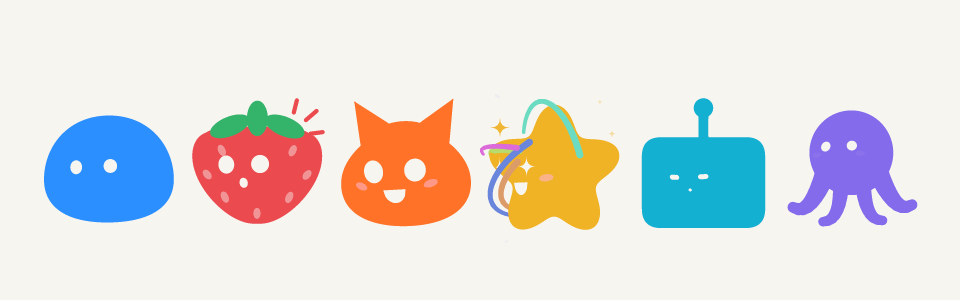
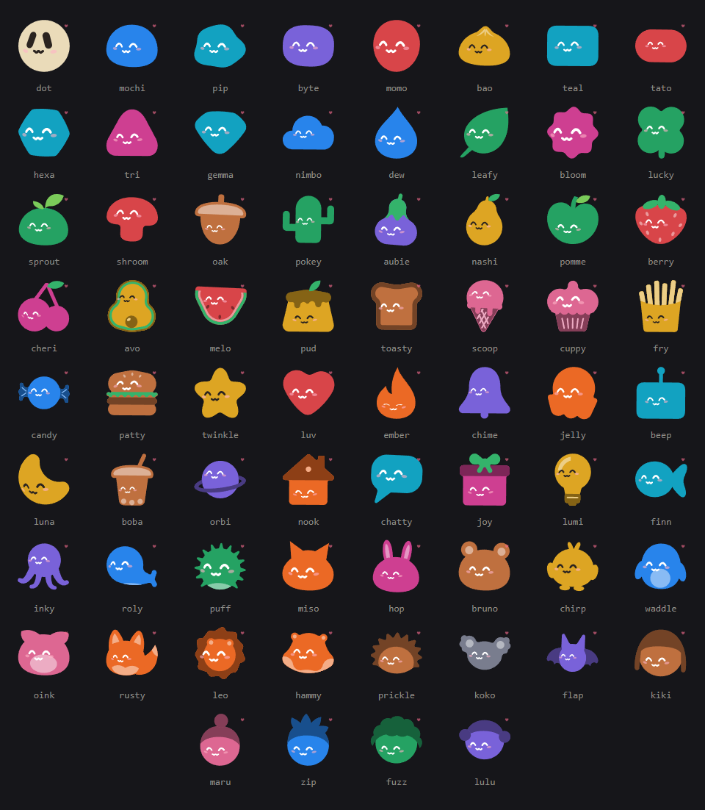
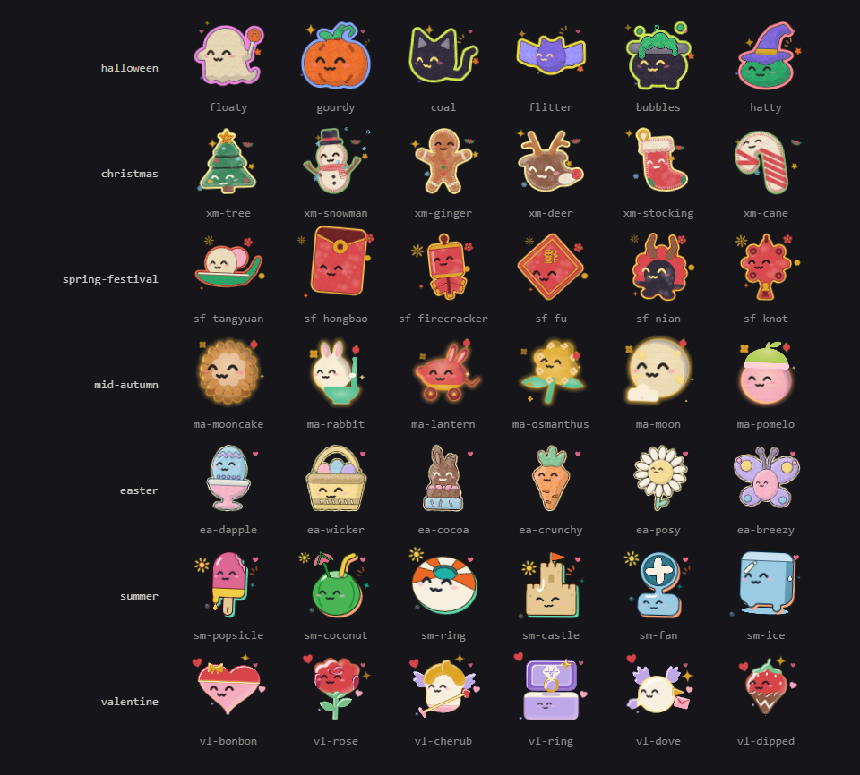
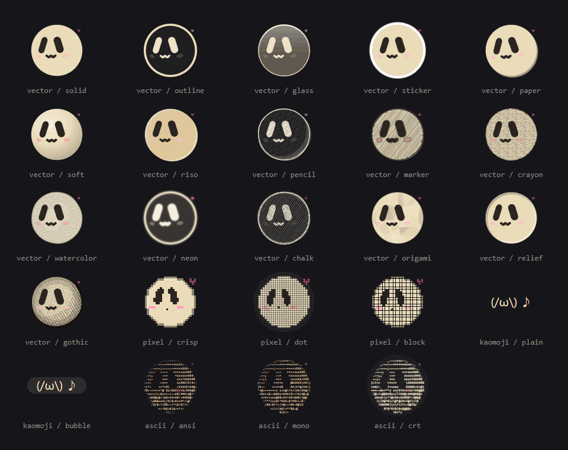
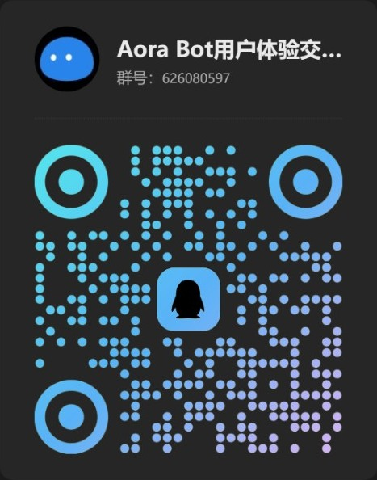

<div align="center">

# Aora Bot

**A procedural character engine for the web: a roster of generated characters with animated states, sixteen faces, four drawing styles and an SVG HUD, plus the UI components built on them.**

[Console](https://aora-bot.vercel.app/en/) | [Documentation](https://aora-bot.vercel.app/en/guide/getting-started) | [Scenarios](https://aora-bot.vercel.app/en/scenarios/chat-stream) | [Emotion Ball](https://sam70361.github.io/aora-bot/) | [中文](./README.md)

[](https://www.npmjs.com/package/@aora-bot/react) [](https://github.com/sam70361/aora-bot/actions/workflows/ci.yml) [](./LICENSE)

</div>

<p align="center">
  
</p>

---

## What this is

Aora Bot's cartoon characters are drawn entirely by code, with no sprite sheets and no
Lottie files. Every body is an outline, with ears, leaves or an antenna drawn as separate
parts; every expression is a few numbers describing a curved stroke, eased by springs; and
every animation frame is written straight to SVG attributes by a `requestAnimationFrame`
loop.

The roster has 71 characters, from round blobs and rice cakes to fruit, treats, critters, objects, people and coal.
Here they all are, happy, each in its own face and colour, led by Dot, the cream-white ball:

<p align="center">
  
</p>

Seven holiday and seasonal themes add 122 more characters: Halloween, Christmas, Spring Festival, Mid-Autumn, Easter, Summer and Valentine's Day. Each theme is its own entry (`@aora-bot/engine/themes/<id>`), loaded only when used, so it adds nothing to the main bundle. See every theme in the [Themes](https://aora-bot.vercel.app/en/themes/) gallery.

<p align="center">
  
</p>

Every character combines independent choices, all of which you can try in the
[console](https://aora-bot.vercel.app/en/): the character itself, the style (`vector`, `pixel`,
`kaomoji` or `ascii`) and its variant, the ink colour, the face and the animation state.

<p align="center">
  
  <br>
  <sub>Dot in every style: <code>vector</code> (<code>solid</code>, <code>outline</code>, <code>glass</code>, <code>sticker</code>, <code>paper</code>, <code>soft</code>, <code>riso</code>, <code>pencil</code>, <code>marker</code>, <code>crayon</code>, <code>watercolor</code>, <code>neon</code>, <code>chalk</code>, <code>origami</code>, <code>relief</code>, <code>gothic</code>), <code>pixel</code> (<code>crisp</code>, <code>dot</code>, <code>block</code>) and <code>kaomoji</code> (<code>plain</code>, <code>bubble</code>).</sub>
</p>

On top of the engine sits a set of React components for what products usually need from
characters: a stable character for every user, derived from any id; shape and colour
pickers; an avatar studio with image cropping; group avatars; chat activity indicators; a
numeric emotion protocol for AI agents; a HUD that draws progress, timers, waveforms and
KPIs in the ring around the character; and a stage that lets hundreds of characters share a
handful of animations. Walkthroughs, restricted-state scenes, template publishing,
occupancy lists and cast lineups live in a separate package built on top of them.

The default face is `cute` (dot eyes, a small mouth and a blush). There are sixteen in all:
`eyes`, the **line face** `line` (a nose and mouth in the same ink and stroke weight as the
eyes) and thirteen drawn faces, chosen with `face`; see
[Face](https://aora-bot.vercel.app/en/design/face).

## Quick start

```bash
pnpm add @aora-bot/react
```

```tsx
import { CharacterMark } from '@aora-bot/react';
import '@aora-bot/react/styles.css';

<CharacterMark shape="mochi" state="happy" sizePx={96} />;
```

Requires React 19. The product components (walkthrough, scenes, template dialog,
occupancy list, cast lineup) are optional and installed separately:

```bash
pnpm add @aora-bot/surfaces @aora-bot/react
```

```tsx
import { RestrictedScene } from '@aora-bot/surfaces';
import '@aora-bot/react/styles.css';
import '@aora-bot/surfaces/styles.css'; // after the react stylesheet
```

Without React, one script tag puts a character on any page:

```html
<script type="module" src="https://cdn.jsdelivr.net/npm/@aora-bot/element"></script>
<aora-bot character="mochi" state="happy" size="96"></aora-bot>
```

When all you need is an avatar image, put an [avatar API](https://aora-bot.vercel.app/en/guide/avatar-api) URL in an ``; the same id always gives the same character:

```html

```

> The CDN script and the avatar endpoint cannot be reached from mainland China yet; installing from npm and bundling with your app is not affected. Access for users in mainland China is planned.

## Packages

| Package              | What it does                                                                                                                                                                                                                       |
| -------------------- | ---------------------------------------------------------------------------------------------------------------------------------------------------------------------------------------------------------------------------------- |
| `@aora-bot/engine`   | The engine: shapes and styles, face fitting, pose projection, a spring integrator, the state machine, belts, HUD dials, particles, the emotion protocol and the arbiter. No React; the `/static` and `/agent` entries need no DOM. |
| `@aora-bot/element`  | The `<aora-bot>` Web Component for pages without React, plus a single-file CDN build that bundles the engine.                                                                                                                      |
| `@aora-bot/react`    | React components: `CharacterMark`, `CharacterStageProvider`, avatars and avatar groups, pickers, the avatar studio, activity badges, HUD plates, agent state, sprites, confetti and locales.                                       |
| `@aora-bot/surfaces` | Product components built on `@aora-bot/react`: the walkthrough, scenes, the template dialog and publishing, the occupancy list and the cast lineup. The engine and the React package are peer dependencies.                        |

Each package has its own README: [`packages/engine`](./packages/engine/README.md),
[`packages/element`](./packages/element/README.md),
[`packages/react`](./packages/react/README.md),
[`packages/surfaces`](./packages/surfaces/README.md).

## Repository layout

```
packages/engine/     from-scratch character engine (TypeScript)
packages/element/    Web Component for pages without React
packages/react/      React component layer
packages/surfaces/   product components on top of the React layer
docs/                Rspress documentation site
api/                 avatar endpoint (Vercel Function)
examples/            standalone samples, not part of the workspace build
```

## From Emotion Ball to Aora Bot

This repository used to hold Emotion Ball, which has now grown into Aora Bot. The classic edition is kept in full in the [`emotion-ball` branch](https://github.com/sam70361/aora-bot/tree/emotion-ball) under its original license. It is no longer updated, but you can still [try it online](https://sam70361.github.io/aora-bot/).

- **A rewritten engine**: a handful of plain JavaScript scripts became four TypeScript packages on npm, with full types, tests and server rendering.
- **Original characters**: all 46 launch characters are original designs, Nimbo and Twinkle from Mood Mates joined the cast as originals too, and the cast has since grown to 71. Emotion Ball's signature little ball lives on as Dot (`dot`), who leads the cast.
- **More to work with**: 32 expressions grew into 44 animation states, with sixteen faces, four styles (vector, pixel, kaomoji and ASCII), HUD dials and a full set of React components. The emotion protocol still accepts `{ emotionId }` messages, so the AI side connects the same way.
- **License**: from free for non-commercial use with separate commercial licensing, through tiered licensing, to MIT: free for anyone, commercial use included.

## Contributing

See [CONTRIBUTING.md](./CONTRIBUTING.md).

## Sponsor

If Aora Bot gave your interface a little more expression, you are welcome to buy the author a coffee.

<table align="center">
  <tr>
    <td align="center">
       <b>WeChat Pay</b>
      <br>
      
    </td>
    <td align="center">
       <b>Alipay</b>
      <br>
      
    </td>
  </tr>
</table>

More about it on the [sponsor page](https://aora-bot.vercel.app/en/sponsor).

## Contact

<table align="center">
  <tr>
    <td align="center">
      
      <br>
      <sub>Add me on WeChat: questions, collaboration or suggestions</sub>
    </td>
    <td align="center">
      
      <br>
      <sub>Join the QQ group: 626080597</sub>
    </td>
  </tr>
</table>

## Become a sponsor

Aora Bot is used mostly by front-end, AI and hardware developers, and by designers making avatars and mascots. Sponsors' logos appear here and on the [sponsor page](https://aora-bot.vercel.app/en/sponsor).

<table align="center">
  <tr>
    <td align="center" colspan="2" width="640" height="100"><b>Lead sponsor</b><br><sub>Open seat</sub></td>
  </tr>
  <tr>
    <td align="center" width="320" height="80"><b>Sponsor</b><br><sub>Open seat</sub></td>
    <td align="center" width="320" height="80"><b>Sponsor</b><br><sub>Open seat</sub></td>
  </tr>
</table>

Its readers are React and front-end developers, AI agent builders, hardware makers, designers and indie developers. Good fits for sponsorship:

- **AI models and agent platforms**: the core audience builds interfaces for AI assistants and agents; the emotion protocol and the Claude Code and Cursor adapters are made for them.
- **Dev boards and smart hardware**: makers putting a face on small screens and desk devices, at the moment they choose the parts for a smart toy or desk companion.
- **Cloud and hosting platforms**: readers are mostly React and front-end developers, and every one of them ships somewhere.
- **Developer tools and IDEs**: the audience writes code every day, and the people who see the logo decide what their team uses.
- **Coding education and courses**: one line of code brings a character to life, which appeals to developers just starting out in front-end and AI work.
- **Design tools and asset platforms**: designers and indie developers come here for avatars, mascots and expressions.

Add me on WeChat above with the note “Aora Bot sponsorship”.

## License

Aora Bot is open source under the [MIT License](./LICENSE), which covers the source code, the character designs (shapes, colours, faces, animation states and their data), the documentation and the examples. Anyone, individual or company, may use, modify and distribute it for free, commercial use included, as long as the copyright and license notice stays in the copies they distribute. Every earlier release may be used under MIT as well.

- **Credit**: not required. A "Powered by Aora Bot" line with a link to this repository, on an About page or in a README, is always appreciated.
- **Name and logo**: the MIT License does not cover trademarks. The [trademark policy](./TRADEMARKS.md) sets out how the "Aora Bot" name and logo may be used.

The classic Emotion Ball is not covered by MIT and keeps the license in its own branch; see the [`emotion-ball` branch](https://github.com/sam70361/aora-bot/tree/emotion-ball).
