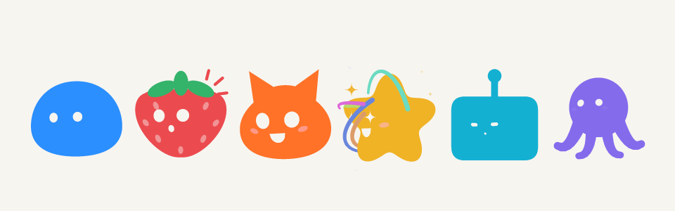
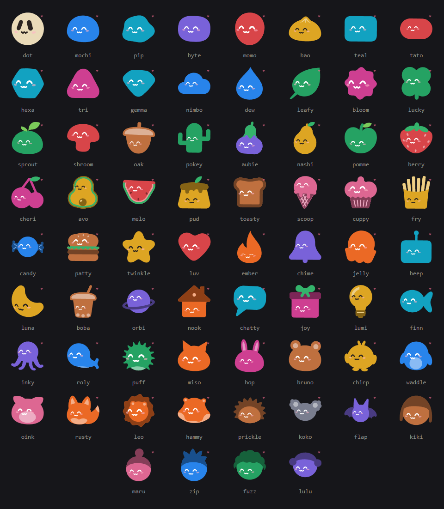
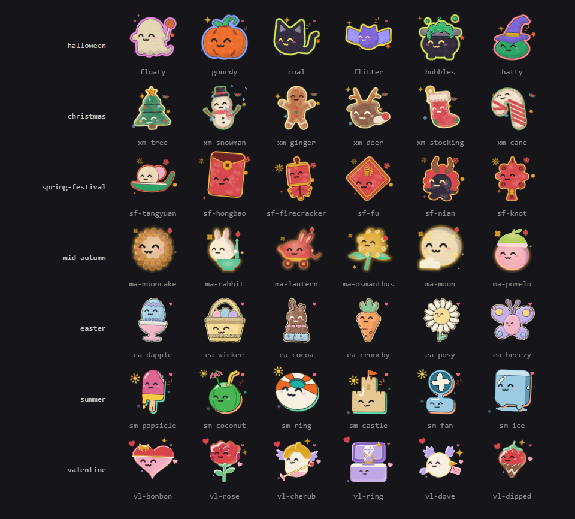
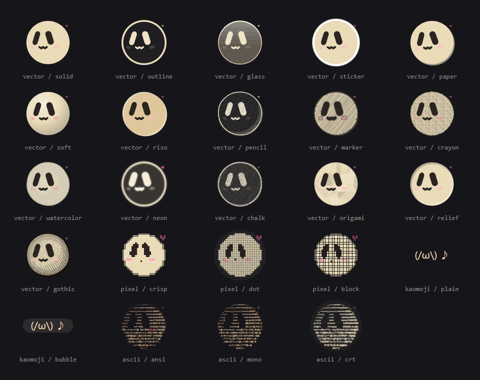
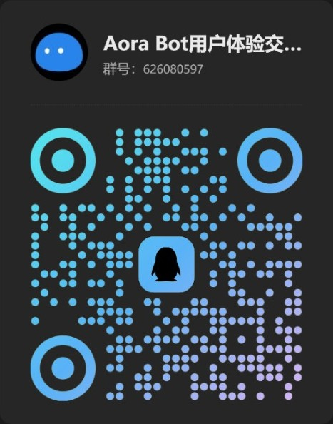

<div align="center">

# Aora Bot

**面向 Web 的程序化角色引擎：一整套由代码生成的角色，配有动画状态、十六种脸型、四种画风和 SVG HUD，以及基于它们的 UI 组件。**

[控制台](https://aora-bot.vercel.app) | [文档](https://aora-bot.vercel.app/guide/getting-started) | [场景](https://aora-bot.vercel.app/scenarios/chat-stream) | [表情馆](https://sam70361.github.io/aora-bot/) | [English](./README.en.md)

[](https://www.npmjs.com/package/@aora-bot/react) [](https://github.com/sam70361/aora-bot/actions/workflows/ci.yml) [](./LICENSE)

</div>

<p align="center">
  
</p>

---

## 这是什么

Aora Bot 的卡通角色完全由代码绘制，不用精灵图，也不用 Lottie 文件。每个角色的身体是一条轮廓线，耳朵、叶子、天线这类部件单独绘制；每个表情是几个数字描述的曲线笔画，由弹簧驱动过渡；每一帧动画都由 `requestAnimationFrame` 循环直接写入 SVG 属性。

阵容共有 71 个角色，从圆滚滚的团子、年糕，到水果、甜点、小动物、物件、人物和煤球。下图是全体成员开心的样子，每个角色都用自己的脸型和颜色，排在第一位的是奶白色的小圆球「球球」：

<p align="center">
  
</p>

此外还有 7 个节日与季节主题：万圣节、圣诞节、春节、中秋节、复活节、夏日和情人节，共 122 个主题角色。每个主题都是单独的入口（`@aora-bot/engine/themes/<id>`），用到时才加载，不会增加主包体积。全部主题见[主题展](https://aora-bot.vercel.app/themes/)。

<p align="center">
  
</p>

每个角色都由几项相互独立的设置组合而成：角色本身、画风（`vector`、`pixel`、`kaomoji` 或 `ascii`）及其变体、墨色、脸型和动画状态。这些都可以在[控制台](https://aora-bot.vercel.app)里直接试。

<p align="center">
  
  <br>
  <sub>球球的所有画风：<code>vector</code>（<code>solid</code>、<code>outline</code>、<code>glass</code>、<code>sticker</code>、<code>paper</code>、<code>soft</code>、<code>riso</code>、<code>pencil</code>、<code>marker</code>、<code>crayon</code>、<code>watercolor</code>、<code>neon</code>、<code>chalk</code>、<code>origami</code>、<code>relief</code>、<code>gothic</code>）、<code>pixel</code>（<code>crisp</code>、<code>dot</code>、<code>block</code>）和 <code>kaomoji</code>（<code>plain</code>、<code>bubble</code>）。</sub>
</p>

引擎之上是一组 React 组件，覆盖产品里常用的角色功能：根据任意 id 给每个用户分配固定的角色，形状与颜色选择器，支持图片裁切的头像编辑器，群组头像，聊天里的活动提示，供 AI 智能体使用的数字情绪协议，在角色外圈显示进度、计时、波形和 KPI 的 HUD，以及让上百个角色共用少量动画的舞台。引导流程、受限状态场景、模板发布、占用列表和角色编排放在另一个包里，基于这些组件构建。

默认脸型是 `cute`（圆点眼、小嘴和腮红）。此外还有 `eyes`、**线条脸** `line`（鼻子和嘴与眼睛同墨色、同线宽）和 13 种手绘脸，共 16 种，用 `face` 选择，见[五官](https://aora-bot.vercel.app/design/face)。

## 快速开始

```bash
pnpm add @aora-bot/react
```

```tsx
import { CharacterMark } from '@aora-bot/react';
import '@aora-bot/react/styles.css';

<CharacterMark shape="mochi" state="happy" sizePx={96} />;
```

需要 React 19。产品组件（引导页、场景、模板对话框、占用列表、角色编排）是可选的，需要单独安装：

```bash
pnpm add @aora-bot/surfaces @aora-bot/react
```

```tsx
import { RestrictedScene } from '@aora-bot/surfaces';
import '@aora-bot/react/styles.css';
import '@aora-bot/surfaces/styles.css'; // 放在 react 样式之后
```

不用 React 时，一个 script 标签就能把角色放进任意网页：

```html
<script type="module" src="https://cdn.jsdelivr.net/npm/@aora-bot/element"></script>
<aora-bot character="mochi" state="happy" size="96"></aora-bot>
```

只需要头像图片时，把[头像接口](https://aora-bot.vercel.app/guide/avatar-api)的地址写进 `` 即可，同一个 id 始终对应同一个角色：

```html

```

> CDN 引入和头像接口目前在中国大陆无法访问；通过 npm 安装、随项目一起打包则不受影响。面向大陆用户的访问方案正在规划中。

## 包

| 包                   | 作用                                                                                                                                                         |
| -------------------- | ------------------------------------------------------------------------------------------------------------------------------------------------------------ |
| `@aora-bot/engine`   | 核心引擎：形状与画风、五官拟合、姿态投影、弹簧积分器、状态机、腰带、HUD 表盘、粒子、情绪协议与仲裁器。不依赖 React，`/static` 和 `/agent` 入口也不依赖 DOM。 |
| `@aora-bot/element`  | `<aora-bot>` Web Component，不依赖 React；另有内置引擎的单文件 CDN 版本，一个 script 标签即可引入。                                                          |
| `@aora-bot/react`    | React 组件：`CharacterMark`、`CharacterStageProvider`、头像与群组头像、选择器、头像编辑器、活动徽标、HUD 底盘、智能体状态、精灵图、庆祝特效和多语言。        |
| `@aora-bot/surfaces` | 基于 `@aora-bot/react` 的产品组件：引导页、场景、模板对话框与发布、占用列表、角色编排。引擎和 React 包作为 peer 依赖。                                       |

每个包都有自己的 README：[`packages/engine`](./packages/engine/README.md)、[`packages/element`](./packages/element/README.md)、[`packages/react`](./packages/react/README.md)、[`packages/surfaces`](./packages/surfaces/README.md)。

## 仓库结构

```
packages/engine/     从零实现的角色引擎（TypeScript）
packages/element/    不依赖 React 的 Web Component
packages/react/      React 组件层
packages/surfaces/   基于 React 组件层的产品组件
docs/                Rspress 文档站
api/                 头像接口（Vercel Function）
examples/            独立示例，不参与工作区构建
```

## 从 Emotion Ball 表情馆到 Aora Bot

本仓库原为 Emotion Ball 表情馆，现已正式升级为 Aora Bot。经典版完整保留在 [`emotion-ball` 分支](https://github.com/sam70361/aora-bot/tree/emotion-ball)，沿用原有授权，不再更新，仍可[在线体验](https://sam70361.github.io/aora-bot/)。

- **引擎重写**：从几个原生 JavaScript 脚本重写为四个 TypeScript npm 包，带完整的类型、测试和服务端渲染支持。
- **原创角色**：首发的 46 个角色全部是原创设计，Mood Mates 的云宝和亮亮也作为原创角色加入阵容，之后阵容扩充到 71 个。表情馆标志性的小圆球化身为球球（`dot`），排在阵容第一位。
- **能力扩展**：32 种表情扩展为 44 种动画状态，另有 16 种脸型、四种画风（矢量、像素、颜文字和 ASCII）、HUD 表盘和一整套 React 组件。情绪协议仍然接受 `{ emotionId }` 消息，AI 一侧的接入方式不变。
- **许可证**：从「非商业免费、商业另行授权」，到分级授权，再到现在的 MIT 开源，任何人都可以免费商用。

## 参与贡献

见 [CONTRIBUTING.md](./CONTRIBUTING.md)。

## 打赏作者

如果 Aora Bot 让你的界面多了一点表情，欢迎请作者喝杯咖啡。

<table align="center">
  <tr>
    <td align="center">
       <b>微信支付</b>
      <br>
      
    </td>
    <td align="center">
       <b>支付宝</b>
      <br>
      
    </td>
  </tr>
</table>

更多说明见[打赏页面](https://aora-bot.vercel.app/sponsor)。

## 联系作者

<table align="center">
  <tr>
    <td align="center">
      
      <br>
      <sub>加我微信交流：使用问题、合作或建议都欢迎</sub>
    </td>
    <td align="center">
      
      <br>
      <sub>加入 QQ 交流群：群号 626080597</sub>
    </td>
  </tr>
</table>

## 成为赞助商

Aora Bot 的用户主要是前端、AI 和硬件开发者，也有设计师用它制作头像和吉祥物。赞助商的标志会展示在这里和[打赏页面](https://aora-bot.vercel.app/sponsor)上。

<table align="center">
  <tr>
    <td align="center" colspan="2" width="640" height="100"><b>首席赞助</b><br><sub>虚位以待</sub></td>
  </tr>
  <tr>
    <td align="center" width="320" height="80"><b>赞助商</b><br><sub>虚位以待</sub></td>
    <td align="center" width="320" height="80"><b>赞助商</b><br><sub>虚位以待</sub></td>
  </tr>
</table>

读者主要是 React 与前端开发者、AI 智能体开发者、硬件创客、设计师和独立开发者。适合的赞助方包括：

- **AI 模型与智能体平台**：核心读者正在为 AI 助手和智能体开发界面，情绪协议以及 Claude Code、Cursor 适配器就是为他们准备的。
- **开发板与智能硬件**：想给小屏幕和桌面设备加上表情的创客与硬件开发者，正在为智能玩具、桌面伙伴挑选方案。
- **云服务与部署平台**：读者以 React 与前端开发者为主，项目做完都要部署上线。
- **开发者工具与 IDE**：读者每天写代码、选工具，看到标志的正是决定团队用什么工具的人。
- **编程教育与课程**：一行代码就能让角色动起来，对正在学习前端和 AI 的新手很有吸引力。
- **设计工具与素材平台**：设计师和独立开发者会来这里挑选头像、吉祥物和表情。

添加上方微信，备注「Aora Bot 项目赞助」即可洽谈。

## 许可证

Aora Bot 以 [MIT 许可证](./LICENSE)开源，范围包括源代码、角色设计（造型、配色、五官、动画状态及相关数据）、文档和示例。个人和公司都可以免费使用、修改和分发，包括商用，只需在分发的副本中保留版权声明和许可声明。此前发布的所有版本也都可以按 MIT 使用。

- **署名**：不强制。如果愿意在关于页面或 README 里写一句「Powered by Aora Bot」并附上本仓库链接，作者会很开心。
- **名称与标志**：MIT 许可证不涉及商标，「Aora Bot」名称和标志的使用规则见[商标政策](./TRADEMARKS.md)。

经典版 Emotion Ball 表情馆不在 MIT 范围内，沿用其分支内的原有授权，见 [`emotion-ball` 分支](https://github.com/sam70361/aora-bot/tree/emotion-ball)。
