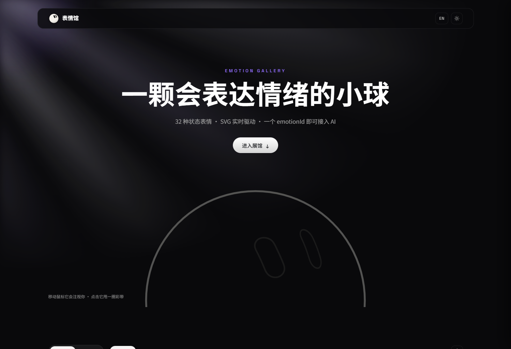
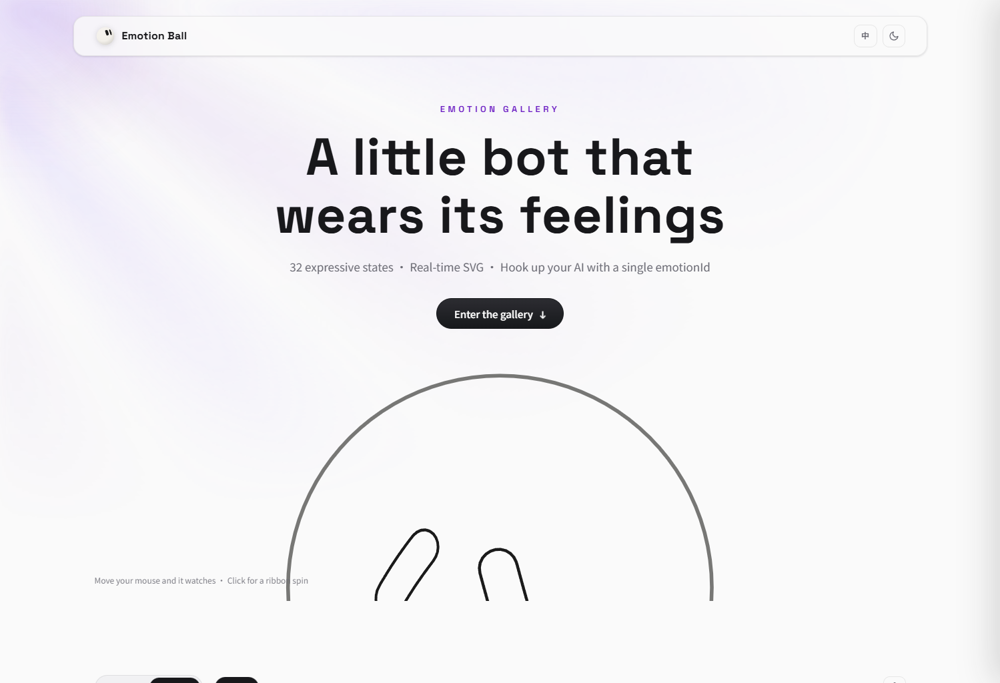
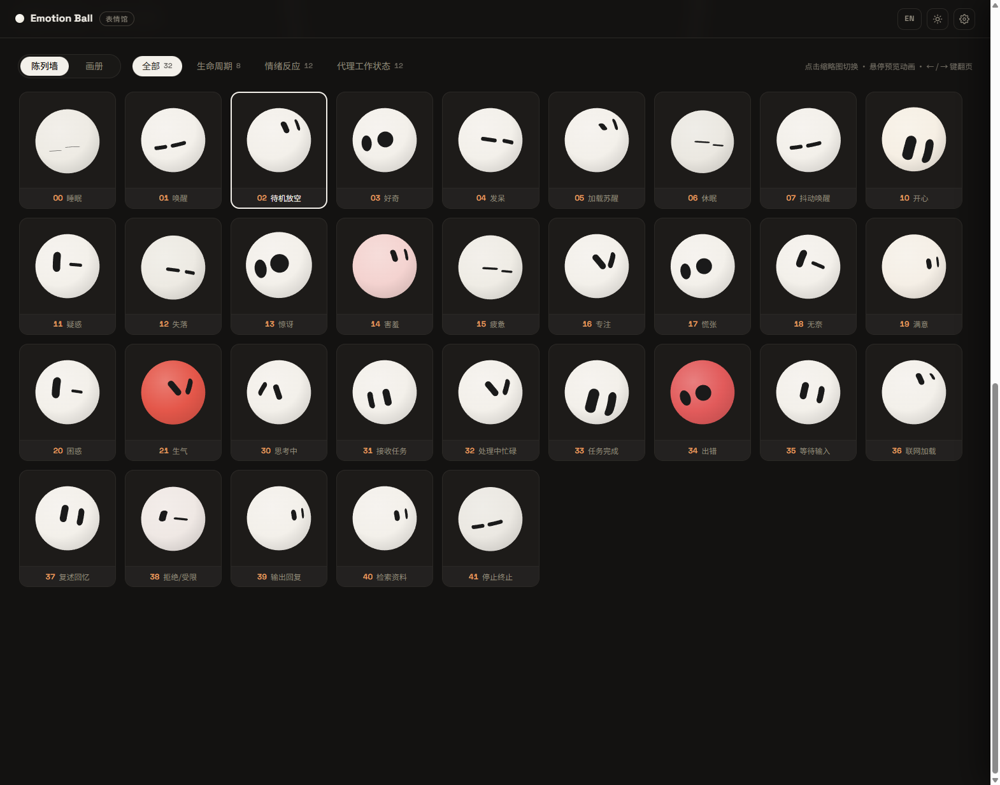
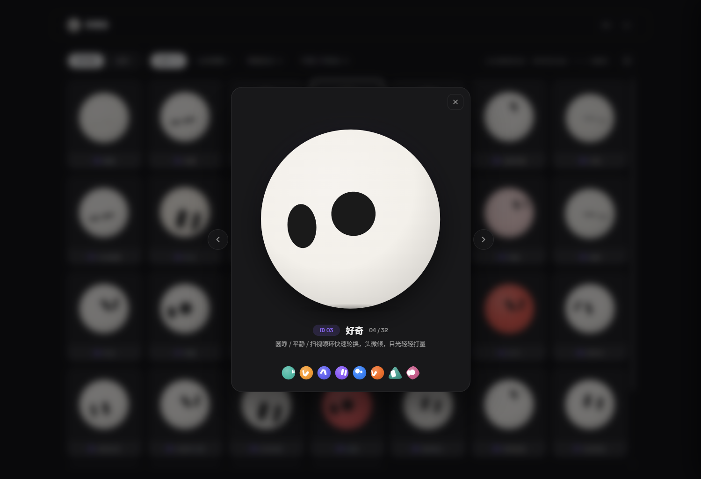
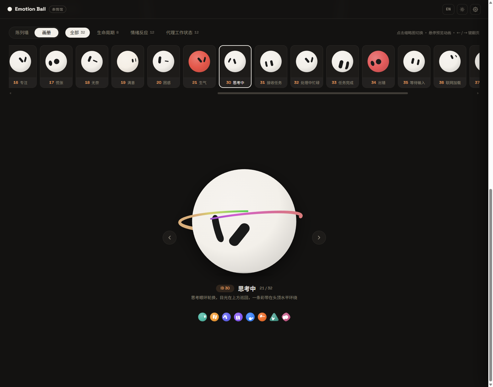

# Emotion Ball 表情馆

**中文** | [English](README.en.md)

AI 表情小球:32 种状态表情,纯 SVG + 原生 JavaScript 实时驱动,零框架、零图片资源。AI 只需输出一个 `emotionId`,小球即可切换到对应表情,也可以作为桌面宠物 / 悬浮助手的表情引擎。自带一个完整的「表情展示馆」站点:开屏线稿 Hero、陈列墙 / 画册双模式、中英双语、明暗双主题。

**在线预览:[emotion-balls.vercel.app](https://emotion-balls.vercel.app/)**

## 预览

| 开屏 Hero(暗黑) | 明亮主题 · English |
| :---: | :---: |
|  |  |

| 陈列墙 | 大图弹窗 |
| :---: | :---: |
|  |  |



## 特性

- **32 种表情**:生命周期(睡眠 / 唤醒 / 待机…)、情绪反应(开心 / 害羞 / 生气 / 惊讶…)、代理工作状态(思考中 / 检索资料 / 出错 / 任务完成…)三大分组,全部配置驱动
- **分段式 emotionId**:十位数字即分组前缀——`00-09` 生命周期、`10-29` 情绪、`30-49` 代理状态、`50+` 自定义;组间空号为新表情预留,已有编号永不重排,对接方可放心硬编码
- **轮廓环眼睛系统**:25 组 48 点轮廓眼环,逐点弹簧插值形变,表情池随机轮换,眨眼带过冲关键帧
- **球面投影**:眼睛按身体轮廓做经度换算 + 余弦压缩,自旋时绕到背面自动隐藏,支持圆胖 / 三角 / 菱形三种身体
- **彩带与撒花**:自旋达速甩出 3D 轨道拖尾彩带(5-stop 色相渐变),思考状态头顶常驻环带,庆祝状态物理粒子撒花
- **鼠标注视**:全页面注视跟随,帧率无关指数平滑,叠加常驻眼神微漂移
- **展示馆站点**:陈列墙(网格 + 点击弹窗大图)与画册(横向长廊 + 大舞台翻页)双模式,设置抽屉,自动巡演,中文 / English,暗黑 / 明亮主题,全部偏好 localStorage 持久化
- **AI 对接**:`ball.handleAIMessage('{"emotionId":"30","tips":"正在思考"}')` 一行接入,未知 ID 自动回退待机
- **零依赖**:HTML + SVG + Vanilla JS,可直接迁移到 Electron 悬浮窗

## 快速开始

```bash
# 任意静态服务器即可,例如:
python -m http.server 8765
# 打开 http://localhost:8765/
```

或直接双击 `index.html`(建议走本地服务器以加载 Google Fonts)。

## 项目结构

```
emotion-ball/
├── index.html          # 站点入口:Hero + 展馆 + 设置抽屉
├── css/style.css       # 双主题变量、双模式布局
├── js/
│   ├── rings.js        # 几何数据:25 组眼环 + 3 种身体轮廓
│   ├── emotions.js     # 32 种表情配置(纯数据,含中英文案)
│   ├── i18n.js         # 界面文案字典(zh / en)
│   ├── ball.js         # 渲染层:SVG 绘制、球面投影、彩带、撒花
│   ├── engine.js       # 驱动层:状态机、弹簧动画、表情池、对外 SDK
│   └── app.js          # 交互层:展示馆站点外壳
├── assets/
│   ├── img/            # 站点图标(favicon)
│   └── screenshots/    # README 预览截图
└── .cursor/skills/     # AI 协作 Skills:表情设计规范 + 集成实践
```

## SDK 用法

```js
// 创建实例
const ball = EmotionBall.create(el, {
  emotion: '02',            // 初始表情
  shape: 'blob',            // blob 圆胖 / wedge 三角 / gem 菱形
  color: '#54B9A6',         // 可选:主题色实例(团队小球)
  idle: true                // 可选:待机策略(超时自动回待机/睡眠)
});

// AI 对接:只需一个 emotionId
ball.handleAIMessage({ emotionId: '30', tips: '正在思考' });

// 其他能力
ball.setEmotion('10');            // 直接切换
ball.spin(2);                     // 自旋甩彩带
ball.burst(20);                   // 撒花
ball.setStyle({ sketch: 1 });     // 线稿模式
ball.startTour(['00','10','30']); // 自动巡演
ball.on('change', e => console.log(e.id));

// 配置注册中心
EmotionBall.config.register({ id: '50', name: '自定义', group: 'custom', ... });
EmotionBall.config.exportConfig(); // 导出全部表情 JSON
```

## 表情配置格式

```js
{
  id: '10', name: '开心', group: 'emotion',
  desc: '笑眼轮换,目光下看看、上看看',
  en: { name: 'Happy', desc: '...' },
  pool: [2, 11, 17, 19],      // 眼环索引池,poolMs 间隔内随机轮换
  blinkMs: [2500, 5000],      // 眨眼间隔(null 不眨)
  antics: true,               // 待机随机小动作(自旋/弹跳)
  body: { breathe: 0.014 },   // 呼吸、颜色、zzz、环带等
  anims: [ { target: 'eyes', prop: 'lookY', type: 'glance', amp: 6, period: 3000 } ],
  sequence: { ... }           // 可选:进入表情时的关键帧序列
}
```

## 许可

本项目**仅供学习与技术交流使用,禁止任何商业用途**(售卖、付费授权、集成到商业产品或服务等)。非商业分享请注明出处。详见 [LICENSE](LICENSE),商业授权请联系作者。
