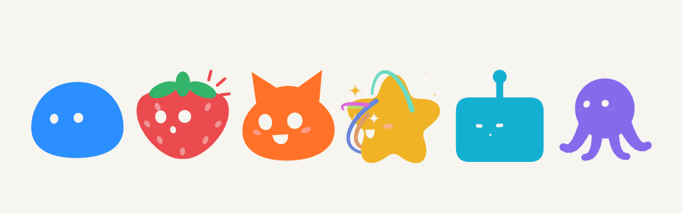
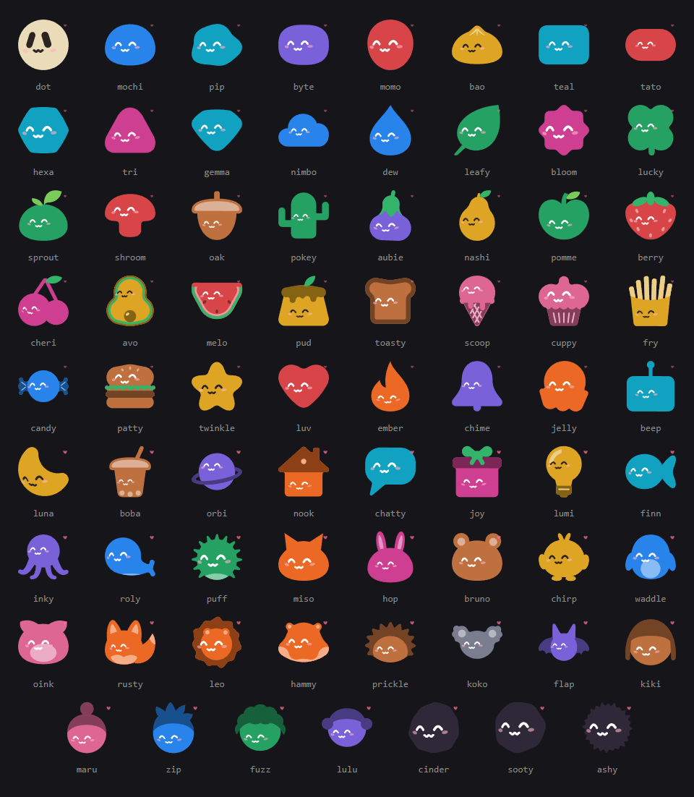
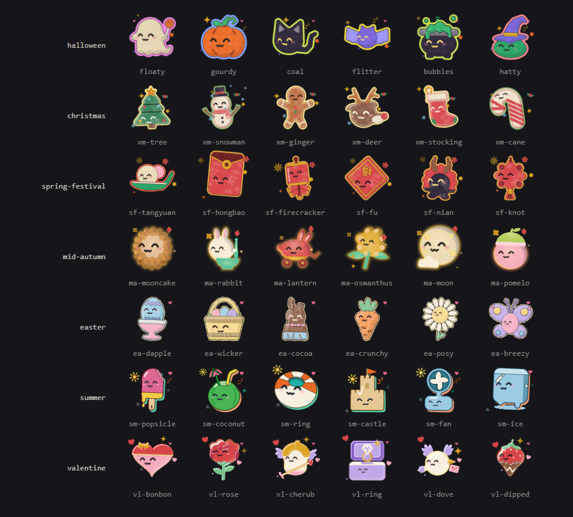
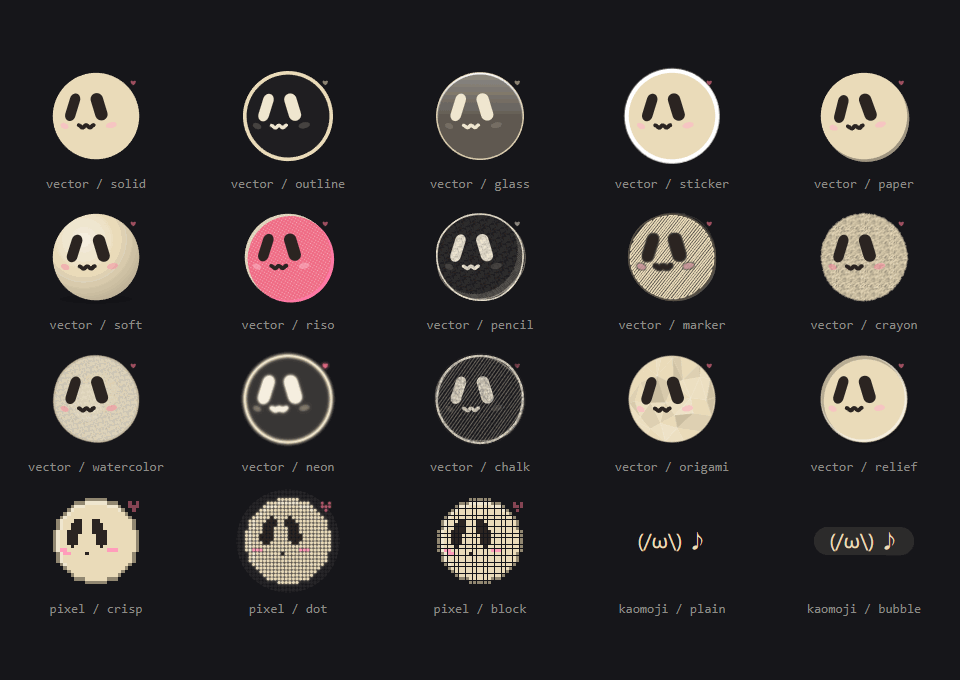
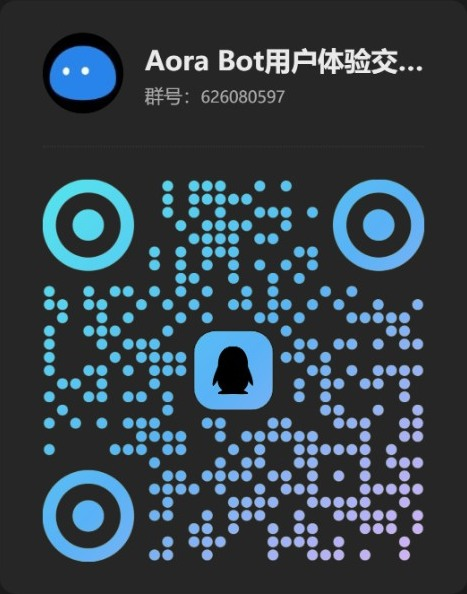

<div align="center">

# Aora Bot

**面向 Web 的程序化角色引擎 —— 一整套生成式角色、动画状态、十六种脸、三种画风、SVG HUD，以及建立在其上的 UI 组件。**

[控制台](https://aora-bot.vercel.app) | [文档](https://aora-bot.vercel.app/guide/getting-started) | [场景](https://aora-bot.vercel.app/scenarios/chat-stream) | [表情馆](https://sam70361.github.io/aora-bot/) | [English](./README.en.md)

</div>

<p align="center">
  
</p>

---

## 这是什么

一个完全由代码绘制的卡通角色。没有雪碧图，没有 Lottie 文件：每个身体都是代码里的一条轮廓
（有的带耳朵、叶子或天线这样的独立部件），每个表情都是几个数字描述的一段曲线笔画、由弹簧插值，
每一帧动画都由一个 `requestAnimationFrame` 循环直接写进 SVG 属性。

角色一共 71 个，从圆滚滚的团子、年糕，到水果、美食、小动物、物件、人物和煤球。下面是全体成员，各自戴着自己的脸、穿着自己的颜色，正开心着，打头的是奶白色的小圆球球球：

<p align="center">
  
</p>

另外还有 7 个节日与季节主题，共 122 个主题角色：万圣节、圣诞节、春节、中秋节、复活节、夏日和情人节。每个主题是一个独立入口（`@aora-bot/engine/themes/<id>`），用到时才加载，不会增加主包体积。全部主题见[主题展](https://aora-bot.vercel.app/themes/)。

<p align="center">
  
</p>

一个角色由几项互相独立的选择组成，都可以在[控制台](https://aora-bot.vercel.app)里直接试：角色本身、画风（`vector`、`pixel` 或 `kaomoji`）及其变体、墨色、脸和动画状态。

<p align="center">
  
  <br>
  <sub>球球的所有画风：<code>vector</code>（<code>solid</code>、<code>outline</code>、<code>glass</code>、<code>sticker</code>、<code>paper</code>、<code>soft</code>、<code>riso</code>、<code>pencil</code>、<code>marker</code>、<code>crayon</code>、<code>watercolor</code>、<code>neon</code>、<code>chalk</code>、<code>origami</code>、<code>relief</code>、<code>gothic</code>）、<code>pixel</code>（<code>crisp</code>、<code>dot</code>、<code>block</code>）和 <code>kaomoji</code>（<code>plain</code>、<code>bubble</code>）。</sub>
</p>

引擎之上是一组 React 组件，覆盖产品真正需要的角色能力：由任意 id 推导出的稳定用户角色、
形状与墨色选择器、带图片裁切的头像编辑器、群组头像堆叠、聊天活动指示器、给 AI 智能体用的
数字情绪协议、在角色外环上画进度/计时/波形/KPI 的 HUD，以及一个让数百个角色共用少量动画的
舞台。引导与受限状态场景、模板发布、占用列表和演员舞台在单独的一个包里，建立在这些组件之上。

默认的脸是 `cute`（圆点眼、小嘴、腮红）。`eyes` 脸和**线条脸** —— 与眼睛同一墨色、同一线宽的
参数化鼻子与嘴 —— 用 `face="eyes"`、`face="line"` 选择。

## 快速开始

```bash
pnpm add @aora-bot/react
```

```tsx
import { CharacterMark } from '@aora-bot/react';
import '@aora-bot/react/styles.css';

<CharacterMark shape="mochi" state="happy" sizePx={96} />;
```

需要 React 19。产品与演示面（引导页、场景、模板对话框、占用列表、演员舞台）是可选的：

```bash
pnpm add @aora-bot/surfaces @aora-bot/react
```

```tsx
import { RestrictedScene } from '@aora-bot/surfaces';
import '@aora-bot/react/styles.css';
import '@aora-bot/surfaces/styles.css'; // 放在 react 样式之后
```

不用 React 时，一行 script 就能把角色放进任意网页：

```html
<script type="module" src="https://cdn.jsdelivr.net/npm/@aora-bot/element"></script>
<aora-bot character="mochi" state="happy" size="96"></aora-bot>
```

只需要一张头像图片时，把[头像接口](https://aora-bot.vercel.app/guide/avatar-api)的地址放进 ``，同一个 id 永远是同一个角色：

```html

```

> CDN 引入和头像接口在中国大陆暂不可用，用 npm 安装、随项目打包的方式不受影响。面向大陆用户的访问方案已在计划中。

## 包

| 包                   | 作用                                                                                                                                                   |
| -------------------- | ------------------------------------------------------------------------------------------------------------------------------------------------------ |
| `@aora-bot/engine`   | 引擎。形状与画风系列、面部拟合、姿态投影、弹簧积分器、状态机、腰带、HUD 表盘、粒子、情绪协议与仲裁器。不依赖 React；`/static` 与 `/agent` 不依赖 DOM。 |
| `@aora-bot/element`  | 不依赖 React 的 `<aora-bot>` Web Component，自带引擎的单文件 CDN 版本，一行 script 即可引入。                                                          |
| `@aora-bot/react`    | React 组件。`CharacterMark`、`CharacterStageProvider`、头像与堆叠、选择器、头像编辑器、活动标记、HUD 底盘、智能体状态、精灵图、彩带、语言提供者。      |
| `@aora-bot/surfaces` | 建立在 `@aora-bot/react` 之上的产品与演示面。引导页组件、场景、模板对话框与发布、占用列表、演员舞台。以 peer 依赖引擎与 React 包。                     |

每个包都有自己的 README：[`packages/engine`](./packages/engine/README.md)、
[`packages/element`](./packages/element/README.md)、
[`packages/react`](./packages/react/README.md)、
[`packages/surfaces`](./packages/surfaces/README.md)。

## 仓库结构

```
packages/engine/     从零实现的角色引擎（TypeScript）
packages/element/    不依赖 React 的 Web Component
packages/react/      React 组件层
packages/surfaces/   建立在 React 层之上的产品与演示面
docs/                Rspress 文档站
api/                 头像接口（Vercel Function）
examples/            独立示例，不参与工作区构建
```

## 从 Emotion Ball 表情馆到 Aora Bot

本仓库原为 Emotion Ball 表情馆。表情馆现已正式升级为 Aora Bot；经典版完整保留在 [`emotion-ball` 分支](https://github.com/sam70361/aora-bot/tree/emotion-ball)，沿用原有授权，不再更新，可以[在线体验](https://sam70361.github.io/aora-bot/)。

- **引擎重写**：从几份原生 JavaScript 脚本，重写为 TypeScript 编写的四个 npm 包，带完整类型、测试与服务端渲染。
- **角色原创**：首发的 46 个角色全部为原创设计，Mood Mates 的云宝和亮亮也作为原创角色加入了阵容，此后阵容扩展到 71 个。表情馆标志性的小圆球以球球（`dot`）的形象延续下来，排在阵容第一位。
- **能力扩展**：32 种表情扩展为 44 种动画状态，新增三种脸，矢量、像素、颜文字三种画风，HUD 表盘和一整套 React 组件。情绪协议仍然接受 `{ emotionId }` 消息，AI 侧的接入方式不变。
- **许可**：从「非商用免费、商业另行授权」改为分级授权：个人、教育、非营利、开源项目和 3 人以内的团队可以免费商用，规模更大的公司购买商业授权。

## 参与贡献

见 [CONTRIBUTING.md](./CONTRIBUTING.md)。

## 打赏作者

如果 Aora Bot 让你的界面多了一点表情，欢迎请作者喝杯咖啡。

<table align="center">
  <tr>
    <td align="center">
       <b>微信支付</b>
      <br>
      
    </td>
    <td align="center">
       <b>支付宝</b>
      <br>
      
    </td>
  </tr>
</table>

更多说明见[打赏页面](https://aora-bot.vercel.app/sponsor)。

## 联系作者

<table align="center">
  <tr>
    <td align="center">
      
      <br>
      <sub>加我微信交流：使用问题、合作或建议都欢迎</sub>
    </td>
    <td align="center">
      
      <br>
      <sub>加入 QQ 交流群：群号 626080597</sub>
    </td>
  </tr>
</table>

## 成为赞助商

Aora Bot 面向前端、AI 与硬件开发者，也被设计师用来制作头像和吉祥物。赞助商的标志会展示在这里和[打赏页面](https://aora-bot.vercel.app/sponsor)上。

<table align="center">
  <tr>
    <td align="center" colspan="2" width="640" height="100"><b>首席赞助</b><br><sub>虚位以待</sub></td>
  </tr>
  <tr>
    <td align="center" width="320" height="80"><b>赞助商</b><br><sub>虚位以待</sub></td>
    <td align="center" width="320" height="80"><b>赞助商</b><br><sub>虚位以待</sub></td>
  </tr>
</table>

主要受众：React 与前端开发者、AI 智能体开发者、硬件创客、设计师与独立开发者。理想赞助伙伴：

- **AI 模型与智能体平台**：核心受众正在给 AI 助手和智能体做界面，情绪协议与 Claude Code、Cursor 适配器正是为他们准备的。
- **开发板与智能硬件**：想给小屏幕和桌面设备加上表情的创客与硬件开发者，正处在为智能玩具、桌面伙伴选型的时刻。
- **云服务与部署平台**：读者以 React 与前端开发者为主，做完都要部署上线。
- **开发者工具与 IDE**：受众每天写代码、挑工具，看到标志的正是决定团队用什么工具的人。
- **编程教育与课程**：一行代码就能让角色动起来，也吸引着正在学习前端与 AI 的新人开发者。
- **设计工具与素材平台**：设计师和独立开发者来这里挑选头像、吉祥物与表情。

添加上方微信，备注「Aora Bot 项目赞助」即可洽谈。

## 许可证

Aora Bot 源码公开，按 [Aora Bot 许可协议](./LICENSE)分级授权：

- **免费使用，包括商用**：个人与独立开发者、学生与教育机构、非营利组织、非营利的开源项目，以及合计不超过 3 人的团队。产品公开发布时，须在关于页面、网站页脚、产品说明或 README 等任一位置注明「Powered by Aora Bot」，并链接至本仓库。
- **商业授权**：规模更大的公司在已上线的产品中使用，须取得商业授权，并可免于署名；评估和原型开发阶段免费。条款与问询模板见 [LICENSE-COMMERCIAL.md](./LICENSE-COMMERCIAL.md)，联系 1251579308@qq.com。
- **所有人都不能做的事**：把引擎或角色单独打包转售，用它提供角色、头像或表情的托管服务，把角色单独做成贴纸、表情包等商品出售，或用角色设计训练生成模型。

经典版 Emotion Ball 表情馆沿用原有授权，见 [`emotion-ball` 分支](https://github.com/sam70361/aora-bot/tree/emotion-ball)。
